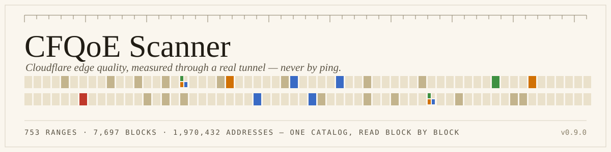
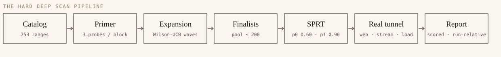

<p align="center">
  
</p>

<p align="center">
  <a href="https://github.com/Altonomega/cfqoe-scanner/actions/workflows/ci.yml"></a>
  
  
  
  
</p>

**CFQoE Scanner** ranks Cloudflare edge IPs by the quality a user actually experiences — not by ping, not by a bare TCP handshake, and not by a parallel burst speed test. Every candidate is measured through a **real Xray tunnel** built from *your own* VLESS + WebSocket configuration: real WebSocket eligibility, real web transfers, sequential HLS streaming with a simulated player buffer, and a real-load stage with sustained download, upload, and latency under load.

It runs entirely on your own machine — Windows, Linux, or Android/Termux — with **zero runtime dependencies** (Node.js ≥ 20 only). Since 0.6.0 it is not a linear pipeline but an adaptive measurement system: every number ships with a confidence interval, a confidence label, and an explicit complete/partial status, and scores are capped by absolute gates so an IP that chokes under real load cannot buy its way to a 90 with easy stages.

---

## Screenshots

The local web UI is the default surface since 0.9.0 — a dashboard ("plate"), the genome view of the whole catalog, live scan consoles, results, reports, settings, and diagnostics, in English and Persian (fully RTL).


*The dashboard: run state, live counters, and the catalog plate at a glance.*


*The genome view in Persian: 7,697 blocks in catalog order, lighting up as the Hard Deep Scan reads them.*

---

## Quick start

**Prerequisite on every platform:** Node.js 20 or newer. Xray is downloaded automatically (official release, SHA-256 verified) the first time a tunnel stage needs it — or install it explicitly with `npm run xray:install`.

### Windows

```bat
git clone https://github.com/Altonomega/cfqoe-scanner.git
cd cfqoe-scanner
Start-CFQoE.cmd
```

See [docs/WINDOWS.md](docs/WINDOWS.md) for details.

### Linux

```bash
git clone https://github.com/Altonomega/cfqoe-scanner.git
cd cfqoe-scanner
chmod +x start-cfqoe.sh
./start-cfqoe.sh
```

### Android / Termux

Keep the project inside the Termux home directory, not in Downloads or `/sdcard`:

```bash
pkg update -y && pkg install -y git && git clone https://github.com/Altonomega/cfqoe-scanner.git && cd cfqoe-scanner && bash install-termux.sh
```

Later runs: `cd ~/cfqoe-scanner && ./start-cfqoe.sh`. Full checklist: [docs/ANDROID-TERMUX.md](docs/ANDROID-TERMUX.md).

### First run

1. Launch the app — the web UI opens in your browser (if it doesn't, the sign-in address is printed in the terminal).
2. Open **Config** and paste your VLESS + WebSocket link. It is stored as a protected local secret file, never transmitted anywhere.
3. Run **System Check** to verify Node, Xray, and the stored configuration.
4. Start with a **Quick Scan**, then read the ranking under **Results**.
5. Go wider with **Full**, deeper with **Research**, or read the whole catalog with **Hard Deep Scan**.

The terminal menu remains available as an explicit fallback: `cfqoe menu`.

---

## Scan modes

| Mode | Candidates | Eligibility rounds | SPRT finalists | Tunnel stage | Streaming | Purpose |
| --- | --- | --- | --- | --- | --- | --- |
| **Quick** | 16 | 2 | 6 | 3 candidates × 1 round | 2 segments | Screening only — a fast first look |
| **Full** | 120 | 3 | 20 | 5 × 1 | 4 segments | The everyday default |
| **Research** | 240 | 6 | 24 | 8 × 3 | 6 segments | Slower, repeated evidence for defensible numbers |
| **Hard Deep Scan** | the whole catalog | block-adaptive | pool ≤ 200 | as Full | 4 segments | Reads all 7,697 blocks; checkpointed and resumable |

**Resume** continues an interrupted Hard Deep Scan from its checkpoint. A Hard run stops safely at any moment (`Q` or `Ctrl+C` in the terminal, Stop in the web UI): the checkpoint is saved as *paused*, the stop reason is recorded, and the results gathered so far are still written.

*Desktop values shown; Android/Termux ships slightly smaller budgets (e.g. 12 SPRT finalists in Full, 3 streaming segments) — see Settings in the app.*

---

## How a scan works

<p align="center">
  
</p>

Quick, Full, and Research sample candidates from the catalog and enter the same pipeline at the eligibility stage; Hard Deep Scan traverses the catalog block by block first (next section). The stages:

1. **Eligibility** — a real WebSocket upgrade using the host, path, and TLS parameters of your own config. A candidate counts only on HTTP `101` with an `Upgrade: websocket` response header *and* a valid `Sec-WebSocket-Accept`; `cf-ray` is recorded when present. TCP connect time is kept as a diagnostic field only — it never enters the score. Transient failures go to a delayed-retry queue, rechecked in Wilson-upper-bound order.
2. **Verification (SPRT)** — finalists are re-probed adaptively under a sequential probability ratio test (`p0 = 0.60`, `p1 = 0.90`, `alpha = 0.05`, `beta = 0.10`). The decision — `accept`, `reject`, or `inconclusive` — is stored in the report.
3. **Real tunnel** — for each surviving candidate the scanner starts a short-lived Xray process whose outbound dials that candidate IP with your WebSocket metadata, exposed through a private SOCKS inbound on `127.0.0.1`. One session per candidate serves all of its rounds; a session that fails is replaced, never nursed. Everything after this point is measured through the tunnel — the full path your client will actually use.
4. **Web Transfer** — cold load, sub-resources, and warm load over one socket per host, capped at runtime (10 assets / 5 MiB on desktop, 8 / 3 MiB on Android). This measures portable HTTP transfer quality — there is no DOM, no JavaScript execution, no rendering.
5. **Streaming** — a real HLS manifest is fetched and segments are downloaded **one at a time**, exactly like a player, under a byte cap (12 MiB desktop, 8 MiB Android), while a player buffer is simulated: only successful segments enter the playable buffer. P10 throughput is reported only with at least 29 samples.
6. **Real Load** — sustained download and upload, idle vs. loaded latency, shaping ratio, fan-out, and requests per minute. Absolute gates cap the score; the default gate profile since 0.9.0 is `tolerant` (warn below 4 Mbps, fail below 1 Mbps sustained), with `balanced` and `strict` selectable.

Before any of this, eligibility concurrency is **calibrated** against a control endpoint: the scanner steps concurrency up only while the failure rate stays close to the control's (a step is rejected when the failure rate grows by more than 0.10 over the control measurement).

The full method — statistics, buffer model, gate tables — is documented in [docs/METHODOLOGY.md](docs/METHODOLOGY.md) and [docs/MEASUREMENT-ENGINE.md](docs/MEASUREMENT-ENGINE.md).

---

## The DNA engine (Hard Deep Scan)

Hard Deep Scan does not sample the catalog — it reads it, the way a sequencer reads a genome: in blocks, adaptively, spending probes where the evidence is.

- The unit is the **/24 block**. The shipped catalog holds **753 ranges, 7,697 blocks, 1,970,432 addresses**.
- **Primer:** every block receives exactly 3 probes — 23,091 probes for the full catalog. A 0/3 primer is triage, not a death sentence (its Wilson upper bound is still 0.562); nothing is discarded by the primer alone.
- **Expansion:** promising blocks receive deeper waves, allocated by a Wilson upper-confidence-bound (UCB) rule, inside a total budget of **72,000 probes on desktop / 40,000 on Android**.
- **Splits:** when a block's two halves disagree — a Fisher exact test at `p ≤ 0.05` *and* an effect of at least 0.5 — the block splits, down to /26 at depth 2, and the halves are read separately.
- **Finalists:** at most 200 candidates (≤ 8 per block into the pool, ≤ 4 per block into the SPRT recheck) go on to the tunnel stages.
- **Reputation:** per-block evidence persists across runs in `data/block-reputation.json` with a 14-day half-life. Blocks seen within 3 days skip the primer; blocks up to 21 days old get one confirmation probe; older blocks are read in full.

The design was validated before it shipped, against seven pre-registered criteria in a deterministic simulation harness (`test/hard-dna-simulation.test.js`, virtual catalog scaled from the real one). Measured: finalist-pool recall **1.000** on both test maps, against **0.100 / 0.200** for the round-robin baselines; primer safety **100%**; false splits **1.3–2.2%**; split detection **0.803**; a warm start reached equal recall at **45%** of the cold run's probes; and the probe sequence is deterministic — identical SHA-256 across runs. The full blueprint and the split-detection analysis live in [docs/HARD-SCAN-REDESIGN.md](docs/HARD-SCAN-REDESIGN.md) and [docs/HARD-SCAN-5B-ANALYSIS.md](docs/HARD-SCAN-5B-ANALYSIS.md).

The previous range round-robin traversal remains available as a per-user kill switch (`hard.engine` in Scan Settings); checkpoints written by it always finish on that engine.

---

## Web UI

Running `cfqoe` with no arguments starts a local web server and opens the UI in your browser. The server is plain `node:http` — still zero dependencies — and it is a control surface, not a dashboard: every one of the terminal menu's twelve actions is there.

- **Views:** Dashboard, Genome (all 7,697 blocks in catalog order, updating live), scan consoles for all four modes, Results, Reports, Settings (the full settings tree), VLESS Config, and Diagnostics.
- **Live by design:** server-sent events stream block deltas in 250 ms batches, counters at 1 Hz, and phase/run-state changes immediately; a sequence gap is healed from a fresh snapshot.
- **Bilingual:** English and Persian with a language toggle; Persian is fully RTL — mirrored layout, right-aligned text, and Latin tokens (IPs, numbers) isolated so they never jumble. A subset of the Vazirmatn font ships with the app (SIL OFL 1.1), so Persian renders consistently even on a stock Windows or Android with no Persian font installed.
- **Local-only security:** the server binds `127.0.0.1` only (port 8797, with an automatic fallback to a free port), guarded by a ≥128-bit session token held in memory only. Your VLESS config is handled **by reference**: the UI sees a descriptor (server, port, transport — never the UUID), and the link itself never appears in any response, error, or log.
- **Terminal fallback:** `cfqoe menu` opens the classic terminal menu; every subcommand below also works headless for scripting and field tests.

---

## Scoring — and its limits

With Real Load enabled (the default):

| Component | Weight |
| --- | --- |
| Web Transfer | 30 |
| Streaming | 30 |
| Real Load | 25 |
| Reliability | 15 |

With Real Load disabled the weights fall back to **45 / 40 / 15** (Web Transfer / Streaming / Reliability). A component that was not measured is dropped and the rest renormalized — but partial evidence is never treated as a complete measurement:

- A candidate missing any weighted component is reported as **`partial`**, its missing components are listed, and its score is **capped at 70**.
- Complete rows always rank above partial rows.
- A candidate that only passed eligibility receives **no QoE score at all**.
- Reliability is ranked by the **lower bound of a Wilson 95% confidence interval**, so a few lucky successes cannot outrank many consistent ones. Each candidate also carries a confidence label — `provisional`, `low`, `medium`, or `high` — describing the stability of the measurement, not the quality of the IP.
- Medians, percentiles, and MAD are used throughout instead of averages, so one observation lost to local congestion cannot dominate a score.

**Run-relative scope, stated plainly:** every report is published with `scope: "run-relative"`. Scores rank candidates *within one run, on one device, on one connection*. Comparing scores across runs, devices, or ISPs is not supported — results depend on your ISP, your Wi-Fi or carrier, the time of day, and the momentary state of the network. The tool's best use is the relative ranking it was built for: these IPs, on this connection, right now.

---

## Settings

Settings live in `data/settings.json` (schema version 7) and are editable from the web UI, the terminal menu, or by hand — writes from the web UI go through the exact same migration and save path as the terminal's, byte for byte. The 0.9.0 defaults were audited against field logs; highlights:

- **Concurrency** is calibrated per run (desktop ceiling 12, Android 6); the calibration tolerance is a 0.10 failure-rate increase over the control (the old 0.02 sat below the granularity of a single failed probe and pinned scans to concurrency 1).
- **Real Load gate profile** defaults to `tolerant` — the `balanced` thresholds (warn 8 / fail 2 Mbps) sat above the measured path class entirely and made the top verdict unreachable.
- **Hard Deep Scan budgets:** 72,000 probes (desktop) / 40,000 (Android); primer 3 per block; SPRT recheck capped at 4 per block so one hot block cannot eat the verification budget.
- **Delayed retry** is on by default: transient failures are rechecked later in the run instead of being retried hot or dropped.

---

## Outputs, logs, diagnostics

| Path | Contents |
| --- | --- |
| `data/settings.json` | Your settings (version 7) |
| `data/config.secret.uri` | Your VLESS link — protected secret file (0600, or a restricted ACL on Windows) |
| `data/block-reputation.json` | Cross-run Hard Scan block reputation |
| `results/run-<id>.json` | Full report (schema 10) |
| `results/latest.json` | The most recent report |
| `results/best-ips.txt` | Plain-text ranking |
| `results/hard-scan/` | Hard Scan checkpoints, retry queue, partial results |
| `logs/run-<id>.ndjson` | Structured run log (schema v2) |

Logs are structured NDJSON with lifecycle records (`run.start` / `run.end`), so a log whose sequence stops mid-phase with no `run.end` *is* the abnormal-termination signal. Retention is automatic: the newest 20 run logs are kept within a total cap of 50 MiB on desktop / 20 MiB on Android, and the current run's log is never pruned.

**Diagnostics** (web UI, terminal menu, or `cfqoe diagnose`) summarizes any run log in one streaming pass — end status, last progress, calibration verdict — without loading the whole file. `cfqoe diagnose --bundle` additionally exports a single redacted `results/debug-bundle-<runId>.json` (run digest, environment facts, settings, the run's own report, and its log records) that is safe to share for troubleshooting: the whole bundle passes through the same redaction path as the logs.

---

## Privacy & security

- **Everything is local.** The scanner talks to Cloudflare edges and the measurement endpoints in the workloads — nothing is sent to any project server, because there isn't one. Your results stay on your device.
- **Your VLESS link is a secret and is treated as one.** It is stored only in `data/config.secret.uri` with restricted permissions; the full URI and UUID never appear in reports or logs (the logger redacts them recursively), and on the web surface the config is referenced by a descriptor that contains no credential.
- **The web UI cannot be reached from your network.** It binds `127.0.0.1` only, requires the session token for every request, validates the `Host` header on every request, and ships no CORS allowances.
- **Xray installs are verified.** The installer fetches only the official release from GitHub and refuses to extract or run anything without a matching SHA-256 digest.
- Temporary Xray configurations are deleted on success, failure, and timeout alike.

More detail: [docs/SECURITY.md](docs/SECURITY.md).

---

## Command line

```bash
cfqoe                     # open the web UI in your browser (default)
cfqoe web                 # same as above
cfqoe menu                # open the terminal menu instead
cfqoe quick               # reduced screening scan
cfqoe scan                # full scan
cfqoe research            # slow, repeated-evidence scan
cfqoe hard                # resumable hard deep scan
cfqoe resume              # resume the last hard scan
cfqoe import <vless-uri>  # store the configuration locally
cfqoe check               # verify Node, Xray and stored configuration
cfqoe results             # print the latest ranking
cfqoe diagnose [file] [--bundle]   # summarize a log; --bundle exports a debug bundle
```

Useful scan flags:

```bash
cfqoe scan --verify-limit 30     # send more finalists to SPRT verification
cfqoe scan --no-verify           # skip verification (faster, weaker evidence)
cfqoe scan --no-retry            # skip the delayed retry of transient failures
cfqoe scan --lowest-variant      # measure the lowest HLS rendition (conservative)
cfqoe scan --no-load             # skip the real-load stage
cfqoe scan --load-duration 40    # seconds of sustained download per observation
cfqoe scan --gate-profile strict # tighter absolute gates: tolerant | balanced | strict
```

---

## Development

```bash
npm test                  # the full suite (custom runner: scripts/run-tests.mjs)
node --check src/cli.js   # the syntax check CI runs
npm run xray:install      # fetch and verify the Xray binary
```

CI runs the syntax check and the suite on **Node 20, 22, and 24 × Ubuntu and Windows**. There is deliberately no install step: the project has **zero runtime dependencies** and no lockfile, and that invariant is part of the design — the web server, the statistics, and the streaming engine are all hand-rolled on `node:` builtins. Contributions that add a runtime dependency will not be merged.

Architecture notes: [docs/ARCHITECTURE.md](docs/ARCHITECTURE.md) · Logging design: [docs/LOGGING.md](docs/LOGGING.md) · Hard Scan operations: [docs/HARD-DEEP-SCAN.md](docs/HARD-DEEP-SCAN.md)

---

## License

CFQoE Scanner is released under the **CFQoE Source-Available Attribution Non-Commercial License 1.0** — full text in [LICENSE](LICENSE). In short: you may use, study, modify, and share the software for non-commercial purposes, provided you retain the license and attribution notices, credit "CFQoE Scanner" by Altonomega, link the original repository where feasible, and mark any changes you made. You may **not** sell, sublicense, or commercially distribute the software or a modified version, remove or falsify attribution, or relicense it under weaker terms. No patent or trademark rights are granted, and the software is provided "as is", without warranty of any kind. Internal use inside your own organization is allowed as long as the software itself is not sold or commercially distributed.

---

## Credits

Built by **Mashani** ([@Altonomega](https://github.com/Altonomega)).

Developed with a specialist AI engineering team led by **TARS** — a Muse agent by Meta — covering core engineering, measurement science, scan methodology, web UI design, logging, security review, and QA. Every release passes an independent verification gate before it ships; the numbers in this README are the numbers the team measured.
